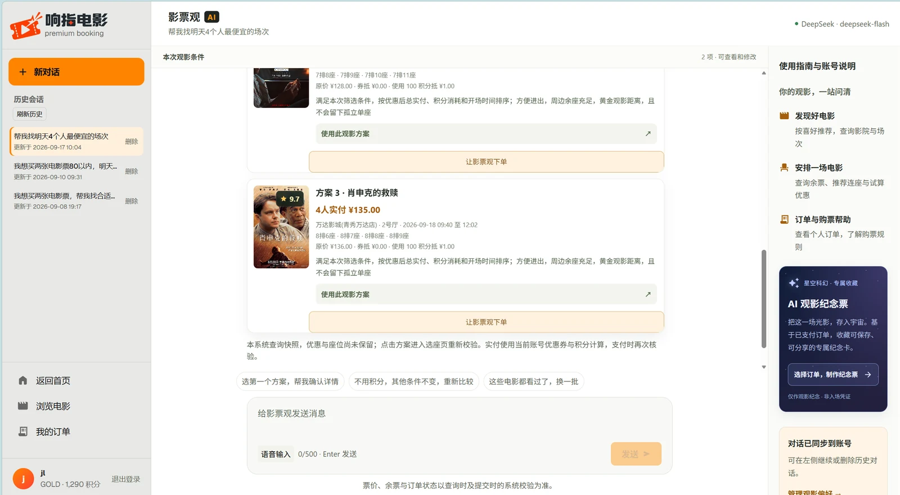
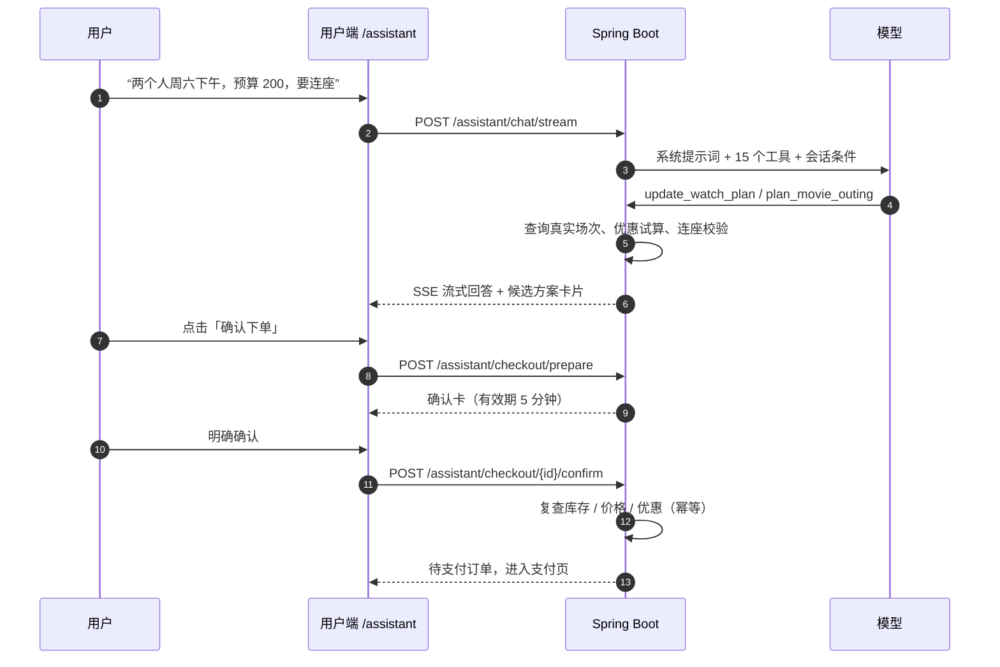
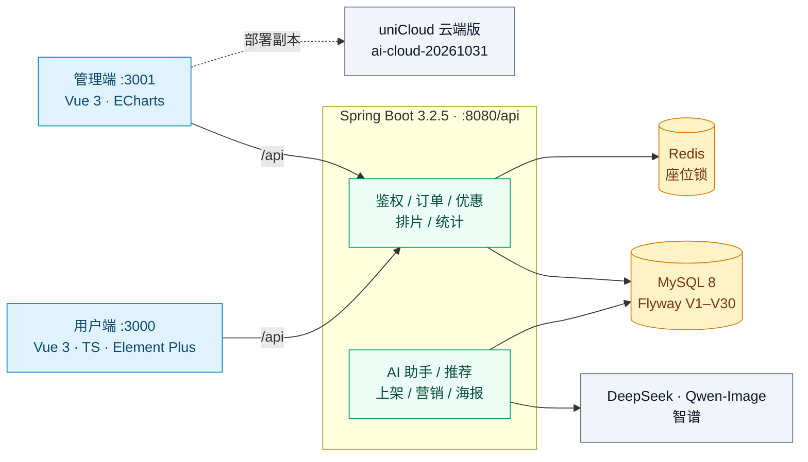
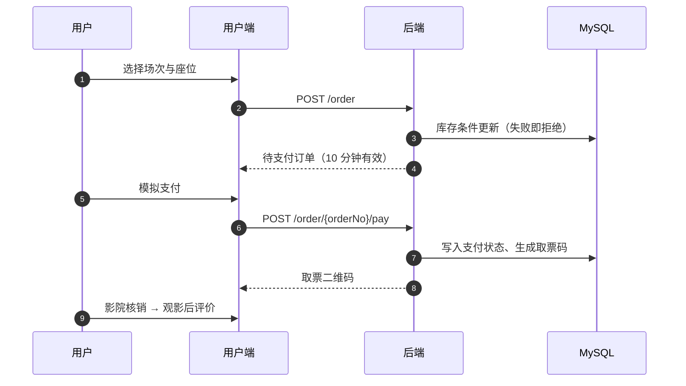

> 本文保留项目的完整功能、接口、测试和部署说明。初次了解项目请先看 [精简首页](README.md)；历史测试与部署结果以各自注明日期的记录为准。

<div align="center">


# 响指电影 · 智能电影购票系统

**从选片、比价、选座到入场核销的一站式影院购票平台**

[](https://github.com/jinli1156/Smart-Movie-System/stargazers)
[](https://github.com/jinli1156/Smart-Movie-System/network/members)
[](https://github.com/jinli1156/Smart-Movie-System/issues)
[](https://github.com/jinli1156/Smart-Movie-System/commits/main)
[](LICENSE)
[](https://github.com/jinli1156/Smart-Movie-System/pulls)

[](https://spring.io/projects/spring-boot)
[](https://openjdk.org/)
[](https://vuejs.org/)
[](https://www.typescriptlang.org/)
[](https://vitejs.dev/)
[](https://www.mysql.com/)
[](https://redis.io/)
[](https://unicloud.dcloud.net.cn/)

[🎬 在线演示](https://www.jinli115.cn/?v=demand-home-20261031) · [🚀 快速开始](#-快速开始) · [🧩 功能地图](#-功能地图) · [🏗 系统架构](#-系统架构) · [📚 文档导航](#-文档导航) · [English](README.en.md)

</div>

> **文档更新：2026-11-01。** 功能以当前源码为准；测试和部署结果以各自注明日期的记录为准。

<details>
<summary><b>📖 目录</b>（点击展开）</summary>

<!-- TOC -->
- [✨ 亮点速览](#-亮点速览)
- [🎬 界面预览](#-界面预览)
- [🚀 快速开始](#-快速开始)
  - [环境要求](#环境要求)
  - [四步跑起来](#四步跑起来)
  - [演示账号](#演示账号)
- [🧩 功能地图](#-功能地图)
- [🧠 AI 能力](#-ai-能力)
  - [15 个业务工具](#15-个业务工具)
- [🏗 系统架构](#-系统架构)
  - [技术栈](#技术栈)
  - [两套实现的能力对照](#两套实现的能力对照)
  - [购票主链路](#购票主链路)
- [📦 项目结构](#-项目结构)
  - [数据模型（Flyway V1–V30）](#数据模型flyway-v1v30)
- [⚙️ 配置项](#-配置项)
- [🔌 核心 API](#-核心-api)
  - [角色与数据权限](#角色与数据权限)
- [✅ 测试与验证](#-测试与验证)
  - [复验命令](#复验命令)
- [☁️ 部署](#-部署)
  - [本地部署](#本地部署)
  - [uniCloud 云端](#unicloud-云端)
- [🗺️ Roadmap](#-roadmap)
- [❓ FAQ](#-faq)
- [📚 文档导航](#-文档导航)
- [🤝 参与贡献](#-参与贡献)
- [📄 许可证](#-许可证)
- [🙏 致谢](#-致谢)
<!-- /TOC -->

</details>

## ✨ 亮点速览

| | 能力 | 说明 |
| :---: | --- | --- |
| 🎟️ | **完整购票闭环** | 电影 → 影院 → 场次 → 选座 → 订单 → 模拟支付 → 取票核销 → 评价 / 退票，全部走真实业务规则 |
| 🤖 | **AI 观影助手** | 15 个业务工具、多轮流式对话、连续观影规划、5 分钟确认卡与幂等下单 |
| 💸 | **智能比价** | 同日跨影院比较优惠后总实付，扣券与积分规则与支付共用同一价格计算器 |
| 📊 | **可复现的推荐实验** | 混合推荐（时间衰减 / 场景 / 内容 / 趋势 / 多样性重排）+ 严格时间 leave-one-out 与消融 |
| 🧠 | **智能排片** | OR-Tools CP-SAT 多目标求解，时间轴可视化调片，草稿暂存与冲突保护（409） |
| 📤 | **AI 上架与 AIGC 营销** | 电影 / 影院 / 影厅资料自动提取成待审草稿；营销文案与海报批量生成、审核、发布与撤下 |
| ☁️ | **双实现对照** | Spring Boot 本地版与 uniCloud 云端版并行维护，差异与验收边界逐项标注 |

## 🎬 界面预览

| 用户端 · 首页 | 用户端 · AI 观影助手 |
| :---: | :---: |
|  |  |

| 管理端 · 登录页 |
| :---: |
|  |

> 截图于 2026-11-01 更新；页面数据和在线服务状态可能变化。

## 🚀 快速开始

### 环境要求

| 依赖 | 版本 | 说明 |
| --- | --- | --- |
| JDK | 21 | 后端编译与运行 |
| Maven | 3.9+ | 仓库自带 Maven Wrapper（3.9.16），可省略本机安装 |
| MySQL | 8.0+ | 需支持 `utf8mb4` |
| Node.js | 18+ | 两个前端工程均需 `npm ci` |
| Redis | 可选 | 默认启动内嵌 Redis，也可连接外部实例 |
| Docker | 可选 | 仅在 `-Integration` 真实依赖集成测试时需要 |

### 四步跑起来

在仓库根目录执行，先按 [配置指南](docs/GETTING_STARTED.md#1-环境准备)设置数据库密码等环境变量：

```powershell
# 1. 创建空数据库
mysql --default-character-set=utf8mb4 -u root -p --execute="SOURCE movie-ticket-backend/src/main/resources/db/schema.sql;"

# 2. 启动后端，等待 Flyway 迁移至 V30
cd movie-ticket-backend
.\mvnw.cmd spring-boot:run
```

需要演示数据时，先停止后端，回到仓库根目录执行以下命令，然后重启后端。**这会清空并重建业务数据。**

```powershell
mysql --default-character-set=utf8mb4 -u root -p --execute="SOURCE movie-ticket-backend/src/main/resources/db/data.sql;"
```

分别在**新的仓库根目录终端**启动两个前端：

```powershell
cd movie-ticket-user
npm ci
npm run dev
```

```powershell
cd movie-ticket-admin
npm ci
npm run dev
```

访问用户端 <http://localhost:3000>、管理端 <http://localhost:3001>；后端 API 前缀 `http://localhost:8080/api`，前端开发代理将 `/api` 转发至后端。

`db/data.sql` 要求 Flyway 完成 V30。排片覆盖北京时间执行当天至未来第 10 天，影院管理员已绑定影院 1，普通用户有新人券及可用兑换码。

### 演示账号

| 用户名 | 本地演示密码 | 角色 | 说明 |
| --- | --- | --- | --- |
| `admin` | `admin123` | 平台管理员 | 全局业务、影院分配、兑换码、推荐评估、营销审核 |
| `cinema_admin` | `admin123` | 影院管理员 | 新版演示种子已绑定影院 1；旧账号仍需分配影院 |
| `user1` | `admin123` | 普通用户 | 购票、助手、海报与纪念票演示 |

账号表对应演示数据初始化，不表示线上账号始终使用这些密码。更完整的环境与排错步骤见 [启动与验收指南](docs/GETTING_STARTED.md)。

## 🧩 功能地图

点击各分组展开细节；完整业务边界与云端差异见后文。

<details>
<summary><b>用户端</b> -&nbsp;<code>movie-ticket-user</code> - 默认 http://localhost:3000</summary>

- **账号与权限**：注册、图片验证码登录、JWT 会话、路由守卫、个人资料编辑、密码修改；后端每次请求检查数据库中的账号状态、角色及影院归属。
- **电影与影院**：电影搜索、类型筛选、热映与待映、详情、海报与预告、票房与影片分析；影院列表、详情、位置与距离展示、地图入口及场次查询。
- **购票闭环**：选择场次、可视化选座、连座推荐、订单确认、优惠试算、模拟支付、订单列表与详情、取消待支付订单、超时取消和退票。
- **取票与评价**：取票码、二维码展示与下载、摄像头扫码或手动输入核销；满足购票观影条件后评价，按评价回写影片评分。
- **个人资产与偏好**：想看列表、冷启动类型偏好、优惠券、兑换码领取、积分抵扣与推荐偏好雷达。
- **影厅布局**：支持停用座位及多条纵向过道；前后端共享座位布局，连座判断不会跨越过道。见 [影厅过道配置](docs/HALL_AISLES.md)。

</details>

<details>
<summary><b>AI 助手、观影规划与确认下单</b> -&nbsp;<code>/assistant</code></summary>

- **业务查询与知识问答**：电影、影院、场次、座位、本人订单、优惠试算和偏好查询；购票规则采用本地关键词知识检索，来源见 [知识库](movie-ticket-backend/src/main/resources/assistant/knowledge.json)。
- **连续观影规划**：记住日期、时间、人数、预算、评分、时长、影院、座位偏好、连座、排除类型/影片及观影场景，支持“改成明天，其他不变”“选第二个”“不用积分”等增量修改。
- **完整方案**：结合真实可售场次、优惠后总预算和连座情况输出候选方案，可带入选座流程；无结果时说明条件交集、预算或连座限制，保留用户条件。
- **会话与长期偏好**：登录用户可恢复、继续和删除历史会话，观影条件独立于最近问答保存；支持保存和管理长期排除偏好，访客状态保留于页面内存。
- **确认下单**：生成包含场次、人数、座位、原价、优惠及预计实付的确认卡，有效期 5 分钟；用户点击或明确确认后，服务端复查库存、价格和优惠，创建待支付订单并进入支付页。
- **幂等与权限**：同一卡片的重复确认返回同一订单；过期、座位占用或报价变化会被拒绝。模型工具只能准备确认卡，支付由用户在支付页完成。
- **聊天交互**：多轮流式回答、停止生成、真实结果卡片，支持浏览器语音输入与回答朗读；模型未配置或不可用时显示对应状态。

当前 [工具定义](movie-ticket-backend/src/main/resources/assistant/tools.json) 包含 **15 个工具**（明细见 [AI 能力](#-ai-能力)）；[系统提示词](movie-ticket-backend/src/main/resources/assistant/system-prompt.md) 与工具执行共同决定助手能力。详细说明：[电影小助手](docs/MOVIE_ASSISTANT.md)、[连续观影规划](docs/ASSISTANT_PLANNING.md)、[AI 确认下单](docs/ASSISTANT_CHECKOUT.md)。

</details>

<details>
<summary><b>智能比价、优惠券与积分</b></summary>

- 电影详情、支付流程和助手支持站内同日跨影院场次比价，比较总实付、影院、影厅、时间及优惠组合。
- 比价使用本系统排片与本人资产；支持日期、人数、用券和积分偏好。页面比价由后端计算，助手自然语言查询需要模型配置。
- 优惠试算与支付共用 [价格计算器](movie-ticket-backend/src/main/java/com/movie/ticket/service/TicketPriceCalculator.java)：每单最多一张券，先扣券，再按 100 积分抵 1 元，积分每单最多抵 1 元，并受余额与剩余应付限制。
- 比价查询不锁座、不占券、不扣积分；余票为查询时的快照，付款时重新校验实际订单和优惠资格。
- 用户可输入兑换码领取优惠券；服务端检查生效时间、有效期、启用状态、发放上限和账号重复领取，同一兑换码每个账号限领一次。
- 平台管理员可维护兑换码、优惠金额、使用门槛、领取后有效天数、最大发放量、生效/截止时间与状态，并查询兑换记录。

详情见 [AI 智能比价](docs/AI_PRICE_COMPARISON.md)。

</details>

<details>
<summary><b>推荐算法与实验评估</b></summary>

- 提供热门、个性化与相似推荐，融合显式偏好、浏览、想看、已支付购票、评价、内容特征、场景与近期趋势，并支持时间衰减、多样性重排、推荐理由和五维偏好雷达。
- 平台管理员可运行严格时间 leave-one-out 评估，比较完整混合模型、热门/纯内容基线和三组消融，记录 Precision@K、Recall@K、NDCG@K、Coverage、Diversity，并导出 JSON。
- 评估会截断未来行为、订单、评价与趋势；缺少历史快照的显式偏好在离线评估时禁用。

实现见 [RecommendController](movie-ticket-backend/src/main/java/com/movie/ticket/controller/RecommendController.java)；实验口径见 [推荐算法评估](docs/RECOMMENDATION_EVALUATION.md) 与 [创新点与实验复现](docs/INNOVATION_EXPERIMENTS.md)。云端规则评估采用独立口径。

</details>

<details>
<summary><b>管理端</b> -&nbsp;<code>movie-ticket-admin</code> - 默认 http://localhost:3001</summary>

- **基础管理**：电影、影院、影厅、场次、订单和用户管理；海报与影院图片上传，订单详情、取消、退票和取票核销。
- **运营与实验**：Dashboard、票房榜、收入趋势、场次统计，以及平台管理员专用的推荐实验和优惠券兑换码管理。
- **AI 辅助上架**（`/listing`）：上传电影、影院或影厅资料，提取为独立待审核草稿，可原文对照、暂存、驳回和确认发布。提供 Excel、CSV、JSON 模板（默认下载中文 Excel），支持 PDF、DOCX、纯文字和图片资料；单批最多 20 条，影院管理员仅能处理所属影院的影厅。见 [AI 辅助上架](docs/AI_LISTING.md)。
- **排片工作台**：选择影院与日期、生成整日草案、时间轴查看与微调、换片、时间与基础票价编辑、添加/移除未锁定场次、检查比较后确认应用。
- **约束与预测**：CP-SAT 按收入、上座率和影片多样性优化，同时约束影厅冲突、片长、清场间隔、上映日期、影片上限和黄金时段；历史预测采用时间外测试，提供 MAE、RMSE、MAPE 及基线。
- **经营分析与 AI 解释**：总览、热力图、单场预测、换片模拟和优化分析使用真实统计与算法结果；模型补充经营建议，响应区分模型来源、算法来源及不可用状态。
- **保存与恢复草稿**：支持服务器暂存、列出、恢复和删除本人草案，并校验当前影院权限。暂存不发布；恢复后的草案应用时仍须重新校验快照与售票状态。
- **发布保护**：已售、待付款、已开场场次保持锁定；应用整日变化使用事务并检查版本与库存变化，发生冲突时返回 409，要求刷新与重新检查。

工作台细节见 [智能排片说明](docs/AI_SCHEDULING.md)。

</details>

<details>
<summary><b>AIGC 营销工作台</b> -&nbsp;<code>/marketing/studio | tasks | review</code></summary>

- 统一入口，页内切换营销创作、任务与素材、审核与发布。运营可按影院和影片批量生成文案与海报，人工编辑后保存内容版本，由平台管理员审核并发布到首页或影院活动位。
- 图片支持阿里云 DashScope `qwen-images` 协议（本机配置为 `qwen-image-3.0`，支持文字与人物参考图），并保留 OpenAI Images 兼容接口与智谱协议；文案默认 `auto`，复用已配置的 DeepSeek，未配置时用智谱文本模型。
- 包含任务恢复、影院权限、版本审核、发布幂等、有效期和撤下；视频生成暂缓。
- uniCloud 副本已迁移营销、上架、个人海报及纪念票，部署结果与验收限制见 [实际部署记录](docs/DEPLOYMENT_AI_2026-10-31.md)。

配置、使用流程与验证方法见 [AIGC 营销工作台](docs/AIGC_MARKETING.md)。真实 Key 仅保存在被 Git 忽略的本机配置中。

</details>

<details>
<summary><b>生成内容：个人海报与观影纪念票</b></summary>

- **AI 个性化电影海报**（用户端 `/posters`）：电影主题、六种风格、一句话创意、可选人物照片和三种画幅；异步生成、历史恢复、PNG 下载与分享。见 [功能说明](docs/AI_PERSONAL_POSTER.md)。
- **AI 观影纪念票**：已支付订单可生成星空科幻纪念卡；AI 创作背景，程序绘制真实订单信息，支持保存 PNG 与分享，并明确标记非入场凭证。见 [功能说明](docs/AI_SOUVENIR_TICKET.md)。

</details>

## 🧠 AI 能力

助手不是独立的聊天壳：每条回答都由真实业务工具取数，确认下单仍走原有订单与库存事务。



### 15 个业务工具

| 工具 | 作用 |
| --- | --- |
| `update_watch_plan` | 增量更新本次观影条件（日期、人数、预算、场景、偏好等），`null` 删除单项 |
| `plan_movie_outing` | 按已保存条件输出完整方案，统一筛选并校验连座与总预算 |
| `discover_movies` | 按类型、评分、时长、排除项与场景筛选影片 |
| `search_movies` | 按关键词、类型、上映状态查询站内影片 |
| `search_cinemas` | 按名称或地址关键词查询营业影院 |
| `search_showtimes` | 全站可售场次统一筛选（片长、时段、影厅、人数、单张票价预算） |
| `compare_prices` | 同日跨影院比价，按本人优惠与积分后的总实付排序 |
| `get_seats` | 查询真实场次的座位布局与占用，不锁座 |
| `recommend_seats` | 复用选座算法推荐可用连座方案 |
| `quote_price` | 只读试算最优优惠券与积分组合 |
| `get_my_orders` | 仅查询本人订单，禁止传入 `userId` |
| `get_my_preferences` | 查询本人类型偏好与行为数量摘要 |
| `recommend_movies` | 个性化推荐（访客为热门推荐） |
| `search_knowledge` | 检索购票、支付、退票、超时与推荐规则，返回可引用片段 |
| `prepare_ticket_order` | 生成确认卡：复查场次、座位、优惠，5 分钟有效，不锁座不下单 |

## 🏗 系统架构



### 技术栈

| 层次 | 技术 | 版本 | 用途 |
| --- | --- | --- | --- |
| 后端 | Spring Boot | 3.2.5 | REST API、事务、SSE 流式响应 |
| 后端 | Java | 21 | 运行时 |
| 后端 | Spring Security + jjwt | 0.12.5 | 无状态 JWT 鉴权，每请求校验数据库中的角色与状态 |
| 后端 | MyBatis-Plus | 3.5.6 | 数据访问与分页 |
| 后端 | Flyway | V1–V30 | 版本化数据库迁移 |
| 后端 | MySQL | 8.0+ | 业务数据、订单与库存 |
| 后端 | Redis | 7（默认内嵌） | 座位锁、缓存 |
| 后端 | OR-Tools CP-SAT | 9.11.4210 | 排片多目标优化求解 |
| 前端 | Vue 3 + TypeScript | 3.4 / 5.3 | 组合式 API、类型约束 |
| 前端 | Vite | 5.1 | 开发服务器与生产构建 |
| 前端 | Element Plus | 2.6 | 组件库 |
| 前端 | Pinia + Vue Router | 2.1 / 4.3 | 状态与路由 |
| 前端 | ECharts | 5.5 | 经营统计与实验图表（管理端） |
| 测试 | JUnit 5 + Testcontainers + Playwright | 1.55 | 快速测试、真实依赖集成、浏览器 E2E |
| 云端 | uniCloud 阿里云（Node.js 云函数 + 云数据库 + 网页托管） | — | 迁移版 API `ai-cloud-20261031` |
| 模型 | DeepSeek / Qwen-Image / 智谱 | — | 助手推理、生图、图文识别，密钥仅在本机私有配置 |

### 两套实现的能力对照

| 能力 | Spring Boot 本地版 | uniCloud 迁移版 |
| --- | --- | --- |
| 数据与座位占用 | MySQL 事务、库存条件更新、Redis 座位锁及数据库占用校验 | `mts_` 集合、云端座位占用与业务处理；真实云事务和并发待验收 |
| 电影推荐 | 混合推荐、严格时间切分、基线和消融实验 | 规则推荐及评估；现有汇总数据可能含后续信息 |
| 排片优化 | OR-Tools CP-SAT 多目标约束求解 | 约束启发式方案；未实现 CP-SAT 求解及全局最优证明 |
| AI 助手 | DeepSeek 工具调用、多轮 SSE、会话与观影计划持久化 | 整段回答、查询工具、会话及确认卡迁移代码；多轮工具流程待完整验收 |
| 超时订单 | 后端定时任务取消超过 10 分钟的待支付订单 | 订单查询或支付时检查并清理；列表每次最多清理 20 笔 |
| 验证方式 | JUnit、隔离 MySQL/Redis 集成、Playwright | 本地 Node.js 测试与云端基础接口验收；内存替身测试不等同于真实云数据库验证 |

### 购票主链路



完整分层、模块职责与数据流见 [架构说明](docs/ARCHITECTURE.md)。

## 📦 项目结构

```text
movie-ticket-system/
├── movie-ticket-backend/                 # Spring Boot 后端
│   ├── src/main/java/com/movie/ticket/   # 控制器、服务、权限、数据访问
│   ├── src/main/resources/assistant/     # 系统提示词、工具定义、规则知识
│   ├── src/main/resources/listing/       # 上架模板与字段白名单
│   ├── src/main/resources/db/flyway/     # 版本化数据库迁移（V1–V30）
│   ├── src/test/                         # 单元、接口与集成测试
│   └── uploads/                          # 本地演示图片
├── movie-ticket-user/                    # Vue 用户端及 Playwright 测试
├── movie-ticket-admin/                   # Vue 管理端及 Playwright 测试
├── movie-ticket-unicloud/                # 独立云端迁移工程
│   ├── frontend/                         # 用户端、管理端副本
│   ├── movie-ticket-unicloud-cloud/      # 云函数与集合 Schema
│   ├── scripts/                          # 清单生成、数据导出、构建与验证
│   └── test/                             # 本地云函数测试
├── docs/                                 # 功能说明、工程参考与历史报告
├── scripts/verify.ps1                    # 本地版统一验收入口
├── .env.example                          # 环境变量示例
└── README.md                             # 本总说明
```

测试截图、论文产物、临时脚本与全量备份属于本机工作产物，已由 `.gitignore` 排除，不随本仓库发布。

### 数据模型（Flyway V1–V30）

| 数据域 | 表 |
| --- | --- |
| 账号、影院、影厅、电影、场次 | `user`、`cinema`、`hall`、`movie`、`showtime` |
| 购票与优惠 | `ticket_order`、`user_coupon`、`coupon_code`、`coupon_code_redemption` |
| 评价与推荐行为 | `comment`、`user_movie_behavior` |
| 助手状态与确认卡 | `assistant_conversation`、`assistant_turn`、`assistant_preference`、`assistant_checkout` |
| 排片草稿 | `scheduling_saved_draft` |
| AIGC 营销工作台 | `marketing_campaign`、`marketing_batch`、`aigc_task`、`marketing_asset`、`marketing_content_version`、`marketing_review_log`、`marketing_publication` |
| AI 辅助上架 | `listing_draft`、`listing_review_log` |
| 个人海报与观影纪念票 | `personal_movie_poster`、`souvenir_ticket` |

另有 V8 创建的迁移孤立行为归档表，以及 Flyway 自身的版本历史表。近期结构迁移：V16 兑换码与钱包字段、V17 会话、V18 观影计划与长期偏好、V19 确认卡、V20 排片草稿、V21 影院管理员归属、V22 演示排片种子、V23 表注释、V24 遗留结构对齐、V25–V26 营销工作台、V27 观影纪念票、V28–V29 AI 上架与批量导入、V30 个人海报。`db/schema.sql` 仅创建空数据库；已有库须先备份，并确认历史 v6 基础结构后由 Flyway 接管。见 [数据库脚本指南](docs/DATABASE.md)。

## ⚙️ 配置项

将需要的变量设置到操作系统、当前终端或 IDE 的运行配置。根目录 `.env.example` 为模板，Spring Boot 不会自动加载它；本机模型配置也可放入已忽略的 `.local/*.properties`。JWT、数据库密码和模型密钥只放服务端私有配置，不进入前端构建。

| 配置 | 用途 |
| --- | --- |
| `DB_URL`、`DB_USERNAME`、`DB_PASSWORD` | MySQL 连接 |
| `JWT_SECRET` | JWT 签名配置 |
| `DEEPSEEK_API_KEY` | 助手、选座与经营分析的模型调用 |
| `AI_ASSISTANT_MODEL`、`AI_ASSISTANT_BASE_URL` | 本地版模型与服务地址覆盖 |
| `MARKETING_IMAGE_PROVIDER`、`MARKETING_IMAGE_MODEL`、`MARKETING_IMAGE_API_KEY` | 营销与海报的图片生成服务 |
| `LISTING_VISION_API_KEY`、`LISTING_VISION_MODEL` | AI 上架的图文资料识别 |
| `SOUVENIR_STORAGE_PATH`、`SOUVENIR_DAILY_LIMIT` | 纪念票资源目录与每日额度 |
| `VITE_AMAP_KEY`、`VITE_AMAP_SECURITY_CODE` | 前端地图与定位，需匹配实际访问域名 |
| `VITE_API_BASE_URL` | 云端前端构建时指定完整的云函数 API 地址 |

本地默认数据库账号为 `root / 123456`，仅用于演示。未配置模型时，基础浏览与购票仍可使用，模型相关能力显示未配置状态。

## 🔌 核心 API

<details>
<summary><b>展开接口清单</b>（统一 `/api` 前缀）</summary>

受保护接口携带 `Authorization: Bearer <token>`；登录须提交验证码标识和验证码。完整路由以 [控制器源码](movie-ticket-backend/src/main/java/com/movie/ticket/controller/) 为准。

| 模块 | 主要接口（省略 `/api` 前缀） |
| --- | --- |
| 认证与资料 | `GET /auth/captcha`、`POST /auth/login`、`POST /auth/register`、`GET /user/me`、`PUT /user/profile`、`POST /user/change-password` |
| 电影、影院、场次 | `GET /movie/page`、`GET /cinema/page`、`GET /showtime/list`、`GET /showtime/{id}/seats` |
| 订单 | `POST /order`、`GET /order/my`、`GET /order/{orderNo}`、`POST /order/{orderNo}/pay`、`POST /order/{orderNo}/cancel`、`POST /order/{orderNo}/refund`、`POST /order/pick` |
| 优惠券 | `GET /coupon/my`、`POST /coupon/redeem` |
| 兑换码管理 | `GET/POST /admin/coupon-codes`、`PUT/DELETE /admin/coupon-codes/{id}`、`GET /admin/coupon-codes/redemptions` |
| 比价与报价 | `GET /pricing/compare`、`GET /pricing/orders/{orderNo}/quote` |
| 推荐 | `GET /recommend/hot`、`GET /recommend/personal`、`GET /recommend/similar/{movieId}`、`GET /recommend/profile/radar`、`GET /recommend/evaluation` |
| 助手 | `GET /assistant/capabilities`、`POST /assistant/chat`、`POST /assistant/chat/stream` |
| 历史与排除偏好 | `GET /assistant/conversations`、`GET/DELETE /assistant/conversations/{id}`、`GET/PUT /assistant/preferences` |
| 助手确认下单 | `POST /assistant/checkout/prepare`、`POST /assistant/checkout/{id}/confirm` |
| 经营统计与排片 | `GET /statistics/dashboard`、`GET /statistics/scheduling/workspace`、`POST /statistics/scheduling/check`、`POST /statistics/scheduling/apply`、`POST /statistics/scheduling/predict`、`POST /statistics/scheduling/simulate`、`POST /statistics/scheduling/optimize` |
| 保存草稿 | `GET/PUT /statistics/scheduling/saved-drafts`、`GET/DELETE /statistics/scheduling/saved-drafts/{id}` |
| AI 辅助上架 | `GET /listing/capabilities`、`GET /listing/templates/{kind}`、`POST /listing/import`、`GET/POST /listing/drafts`、`GET/PUT /listing/drafts/{id}`、`POST /listing/drafts/{id}/reject`、`POST /listing/drafts/{id}/publish` |
| 营销工作台（后台） | `GET /admin/marketing/capabilities`、`GET/POST /admin/marketing/campaigns`、`POST /admin/marketing/campaigns/{id}/batches`、`POST /admin/marketing/campaigns/{id}/versions`、`POST /admin/marketing/versions/{id}/submit-review`、`POST /admin/marketing/versions/{id}/review`、`POST /admin/marketing/versions/{id}/publish`、`POST /admin/marketing/publications/{id}/offline` |
| 营销展示位（公开） | `GET /marketing/placements`、`GET /marketing/assets/{id}` |
| 个人海报 | `GET /posters/capabilities`、`GET/POST /posters`、`GET /posters/{id}`、`POST /posters/{id}/retry`、`GET /posters/{id}/file` |
| 观影纪念票 | `GET /souvenirs/capabilities`、`GET/POST /souvenirs/orders/{orderNo}`、`GET /souvenirs/{id}/file` |
| 图片上传 | `POST /upload/image` |

</details>

### 角色与数据权限

| 角色 | 数据范围与主要权限 |
| --- | --- |
| 普通用户 `USER` | 查询公开目录，管理本人资料、订单、优惠券、兑换码领取、想看、评价、助手会话，以及本人 AI 个人海报与已支付订单的纪念票 |
| 影院管理员 `CINEMA_ADMIN` | 管理所属影院的资料、影厅、场次、订单、核销、经营统计和排片；AI 上架仅能处理所属影院的影厅；营销内容按影院范围提交；排片草稿还须属于本人 |
| 平台管理员 `ADMIN` | 全局业务管理、影院分配、用户管理、电影库、兑换码维护、推荐算法评估，以及营销内容的审核与发布 |

影院管理员未分配影院时，管理请求返回 403。用户角色、影院或禁用状态变化后，旧 JWT 在下一次请求即按数据库中的新权限处理。完整矩阵与回归方法见 [影院权限与页面一致性](docs/CINEMA_PERMISSIONS.md)。

云端映射清单见 [api-inventory.json](movie-ticket-unicloud/api-inventory.json)；具有同名接口不代表两套算法与事务已经通过等价验证。

## ✅ 测试与验证

| 日期与记录 | 已记录结果 | 范围与限制 |
| --- | --- | --- |
| [2026-09-07 系统测试](docs/SYSTEM_TEST_REPORT_2026-09-07.md) | 合计 160 项通过：后端快速 77、本机依赖集成 24、用户端浏览器 32、管理端浏览器 2、HTTP 检查 25；两端构建通过 | 另有模型和 Docker 条件用例跳过；真实本机依赖版本与 Docker 标准组合不同 |
| [2026-09-07 混合业务压测](docs/LOAD_TEST_200_USERS_5MIN_2026-09-07.md) | 200 个活跃虚拟用户持续 5 分钟，59,658 请求，0 失败，库存与订单一致性检查通过 | 本机、小型数据、每次操作间隔 0.5–1.5 秒；不能推导生产容量或 200 人同座抢票表现 |
| [2026-09-10 AI 确认下单](docs/ASSISTANT_CHECKOUT.md) | 后端 148 项中累计 144 通过、4 跳过；用户端相关浏览器 39 项通过；V19 与 15 工具能力检查完成 | 幂等和回滚使用隔离数据；真实模型测试使用合成库存 |
| [2026-09-27 权限回归](docs/CINEMA_PERMISSIONS.md) | 后端快速 163 项：158 通过、5 项模型条件测试跳过；真实 MySQL/Redis 权限用例通过；管理端 5、用户端 14 项浏览器用例通过；两端构建通过 | 浏览器数据用于交互验证；权限验证不等同于算法商业效果或云端验收 |
| [2026-10-31 AI 升级部署](docs/DEPLOYMENT_AI_2026-10-31.md) | 云端本地回归 46 项中 45 通过、1 项因快照无未来场次跳过；后端 23 项检查、页面分轮回归（用户端 21 项、管理端 42 项）；线上登录、四模块能力、XLSX 模板、资料提取与权限拦截通过；真实生图个人海报 1152×1536、营销海报 1152×1536；营销发布与撤下、纪念票流程通过 | 仅新增 1 张测试生图海报，未批量生图；测试账号无已支付订单，纪念票未做真实订单生图；自定义域名根首页旧 CDN 缓存未刷新；模拟浏览器检查不等同真实云事务验收 |

浏览器套件大量使用 HTTP 响应拦截；后端持久化、事务和竞争由独立集成测试验证。云函数本地测试使用内存数据库替身，云端真实锁座、支付、退票及故障恢复仍需单独验证。

### 复验命令

```powershell
# 后端快速测试与两端生产构建
powershell -ExecutionPolicy Bypass -File scripts/verify.ps1

# 首次安装或需要重装前端依赖
powershell -ExecutionPolicy Bypass -File scripts/verify.ps1 -Install

# 再执行真实依赖集成与两端 Chromium 浏览器套件（需要 Docker）
powershell -ExecutionPolicy Bypass -File scripts/verify.ps1 -Integration -E2E
```

`-Integration` 需要 Docker；没有 Docker 时相关 Testcontainers 用例可能跳过，跳过不计为验证通过。`-E2E` 会安装 Playwright Chromium 并执行浏览器测试。真实模型测试采用各套件的显式开关，调用会产生模型费用。脚本任一步失败返回非零退出码。

uniCloud 本地云函数回归从独立工程执行：

```powershell
cd movie-ticket-unicloud
$cloudTestFiles = @(Get-ChildItem -LiteralPath test -Filter '*.test.js' -File | Select-Object -ExpandProperty FullName)
node --test @cloudTestFiles
```

详细分层与单独运行方法见 [自动化测试指南](docs/TESTING.md)。

## ☁️ 部署

### 本地部署

按 [快速开始](#-快速开始) 依次完成数据库、后端与两个前端即可。生产构建：`npm run build`（前端）、`.\mvnw.cmd clean package`（后端）。

### uniCloud 云端

部署目标为阿里云服务空间 **dy**（`mp-e7a16837-eb5c-4898-8fbd-e967f4d747d6`，基础版，记录写明 2026-11-08 到期），按 [2026-10-31 实际部署记录](docs/DEPLOYMENT_AI_2026-10-31.md) 与 [uniCloud 工程 README](movie-ticket-unicloud/README.md) 汇总：

| 入口 | 地址 |
| --- | --- |
| 用户端（临时新版） | <https://www.jinli115.cn/?v=demand-home-20261031> |
| 管理端 | <https://www.jinli115.cn/admin/> |
| 默认托管域名 | <https://static-mp-e7a16837-eb5c-4898-8fbd-e967f4d747d6.next.bspapp.com/> |
| API 健康检查 | <https://fc-mp-e7a16837-eb5c-4898-8fbd-e967f4d747d6.next.bspapp.com/api/health>（返回 `ai-cloud-20261031`） |

已上传 24 个 `mts_` 集合的 Schema/索引、`movie-api`、`movie-ai-worker`、`movie-maintenance` 与两端静态资源（最近一次 HBuilderX 报告 208 个文件成功、0 失败）。其中 19 个集合随 2026-10-09 迁移上传，18 个业务集合由 2026-09-25 MySQL 快照导入，运行时验证码集合未导入；2026-10-31 新增 `mts_ai_job`、`mts_ai_quota`、`mts_ai_lock`、`mts_listing_draft`、`mts_marketing` 5 个禁止客户端直接读写的集合，原有业务数据未重导或重置。

AI 已改为按需执行：API 仅在存在待处理任务时调用 `movie-ai-worker`，每次最多 2 个任务、最长 120 秒；模型任务与图片链接仅保留 24 小时。用户侧用量快照为 2081.08 / 10000 GBs（20.81%）。原每分钟触发器已改为每年执行一次的占位表达式，**年度触发器仍在云端，完整删除须在控制台操作**。

云端待完成或复核项：

1. 在控制台刷新自定义域名首页 `/` 与 `/index.html` 的 CDN 缓存，再核对普通首页入口。
2. 网页托管 404 页面指向根目录 `index.html`，验证用户端 history 路由刷新；管理端使用 `/admin/` 下的 hash 路由。
3. 在控制台删除已停用的 `movie-data-import` 一次性导入函数，并删除遗留的年度占位触发器。
4. 分配影院管理员的所属影院，再验收跨影院数据边界。
5. 验证真实云数据库事务、锁座并发、订单与优惠券一致性、确认卡幂等、故障恢复及全部关键业务流程。
6. 验证 AI 查询工具的多轮对话，并核对推荐、预测与连座算法和本地版的差异；云端排片优化仍为启发式实现，未迁移 CP-SAT。
7. 纪念票未做真实订单生图验收；基础版到期 2026-11-08，续费或套餐调整以控制台状态为准。

旧空间 **bs** 的 2026-09-30 额度耗尽属于迁移前历史记录；`movie-maintenance` 定时触发器已按当时记录删除，当前代码使用请求时清理超时订单。重新构建和部署须使用独立副本、正确的 URL 化 API 地址、前端地图配置及托管域名；静态资源更新后刷新 CDN 缓存。

## 🗺️ Roadmap

- [x] 购票闭环、模拟支付、取票核销、退票与评价
- [x] 混合推荐 + 严格时间切分评估与消融
- [x] AI 助手（15 工具）、连续观影规划、确认下单
- [x] 智能比价、兑换码与积分体系
- [x] 智能排片：CP-SAT 优化、预测、模拟与草稿
- [x] AI 上架、AIGC 营销、个人海报、观影纪念票
- [x] uniCloud 云端版与 AI 按需上线
- [ ] 真实支付渠道与改签流程
- [ ] 云端真实事务、并发与故障恢复验收
- [ ] CI（构建 + 快速测试 + 两端构建）与容器化部署
- [ ] 英文文档补全与国际化

## ❓ FAQ

<details>
<summary><b>没有模型 Key 能跑起来吗？</b></summary>

能。数据库、后端、两个前端可直接运行；浏览、购票、支付、取票、评价等链路不依赖模型。AI 助手、智能比价（自然语言）、排片 AI 解释、上架资料识别与生图会显示未配置状态，配置 `.local/*.properties` 后即可启用。

</details>

<details>
<summary><b>必须安装 Redis 和 Docker 吗？</b></summary>

都不必。默认配置会启动内嵌 Redis；Docker 只在执行 `scripts/verify.ps1 -Integration` 的真实依赖集成测试时需要。

</details>

<details>
<summary><b>导入 data.sql 报错？</b></summary>

`data.sql` 会重置全部业务数据，且要求 Flyway 完成 V30。请先启动后端完成迁移、**停止后端**，再在仓库根目录执行导入；已有重要数据的库不要执行。历史库需先备份，并确认 v6 基线结构由 Flyway 接管。

</details>

<details>
<summary><b>云端演示地址为什么带版本参数？</b></summary>

自定义域名根首页仍命中旧 CDN 缓存，`?v=demand-home-20261031` 用于确保加载新资源。控制台刷新 `/` 与 `/index.html` 缓存后即可使用干净地址，详见 [实际部署记录](docs/DEPLOYMENT_AI_2026-10-31.md)。

</details>

<details>
<summary><b>云端版和本地版算法一样吗？</b></summary>

不一样，且已在文档中逐项标注：云端排片为启发式方案、推荐为规则评估，未宣称与本地 CP-SAT / 混合推荐等价。对照见 [两套实现的能力对照](#两套实现的能力对照)。

</details>

## 📚 文档导航

| 主题 | 文档 |
| --- | --- |
| 本地运行与测试 | [启动与验收](docs/GETTING_STARTED.md)、[自动化测试](docs/TESTING.md) |
| AI 查询、会话、规划与下单 | [电影助手](docs/MOVIE_ASSISTANT.md)、[观影规划](docs/ASSISTANT_PLANNING.md)、[确认下单](docs/ASSISTANT_CHECKOUT.md) |
| 智能比价与座位布局 | [AI 比价](docs/AI_PRICE_COMPARISON.md)、[影厅过道](docs/HALL_AISLES.md) |
| 推荐与排片 | [推荐算法评估](docs/RECOMMENDATION_EVALUATION.md)、[创新点实验](docs/INNOVATION_EXPERIMENTS.md)、[智能排片](docs/AI_SCHEDULING.md) |
| AIGC、上架与生成内容 | [AIGC 营销工作台](docs/AIGC_MARKETING.md)、[AI 辅助上架](docs/AI_LISTING.md)、[个人海报](docs/AI_PERSONAL_POSTER.md)、[观影纪念票](docs/AI_SOUVENIR_TICKET.md) |
| 权限、核销与取票 | [影院权限](docs/CINEMA_PERMISSIONS.md)、[取票功能](docs/features/TICKET_PICKUP.md) |
| 云端迁移与部署 | [uniCloud 总说明](movie-ticket-unicloud/README.md)、[2026-10-31 上线检查](docs/DEPLOYMENT_PREFLIGHT_2026-10-31.md)、[实际部署记录](docs/DEPLOYMENT_AI_2026-10-31.md) |
| 历史测试证据 | [2026-09-07 系统测试](docs/SYSTEM_TEST_REPORT_2026-09-07.md)、[200 用户压测](docs/LOAD_TEST_200_USERS_5MIN_2026-09-07.md) |
| 工程与设计参考 | [架构说明](docs/ARCHITECTURE.md)、[数据库指南](docs/DATABASE.md)、[早期设计文档](docs/design/SYSTEM_DESIGN.md)、[已有变更记录](docs/CHANGELOG.md) |

专题文档中部分章节仍保留早期实现或数量描述；核对当前接口与表结构时使用控制器源码和 Flyway 目录，核对测试与部署时使用有日期的记录。后续新增功能应同步修改本总览、对应专题说明，以及受影响的提示词、工具和规则知识。

## 🤝 参与贡献

欢迎 Issue 与 Pull Request：

1. Fork 本仓库并从 `main` 拉出功能分支。
2. 提交前在本地执行 `scripts/verify.ps1`，涉及集成行为时补充 `-Integration`；改动接口或表结构时同步更新本文档与对应专题说明。
3. PR 描述请说明改动动机、影响范围与验证方式；测试结论请标注日期、范围与环境。

如果这个项目对你有帮助，欢迎点个 **Star** ⭐，或把 [在线演示](https://www.jinli115.cn/?v=demand-home-20261031) 分享给需要做影院 / 票务 / AI 应用练手的人。

<a href="https://github.com/jinli1156/Smart-Movie-System/graphs/contributors">
  
</a>

## 📄 许可证

本项目基于 [MIT License](LICENSE) 开源。

## 🙏 致谢

- [Spring Boot](https://spring.io/projects/spring-boot)、[Vue](https://vuejs.org/)、[Element Plus](https://element-plus.org/)、[MyBatis-Plus](https://baomidou.com/)、[Flyway](https://flywaydb.org/)、[OR-Tools](https://developers.google.com/optimization)、[uniCloud](https://unicloud.dcloud.net.cn/) 等开源与服务项目。
- 感谢所有参与需求讨论、测试与验收的同学与老师。

<div align="center">

<a href="https://star-history.com/#jinli1156/Smart-Movie-System&Date">
  
</a>

**[⬆ 回到顶部](#响指电影--智能电影购票系统)**

</div>
