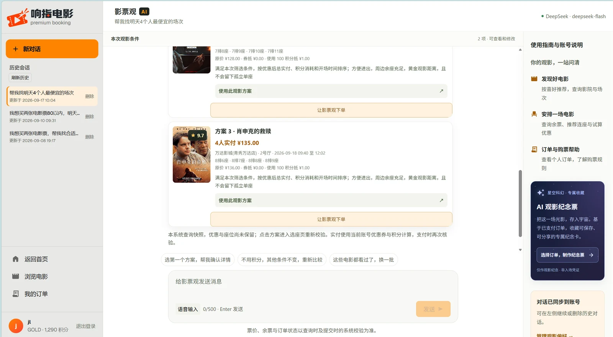
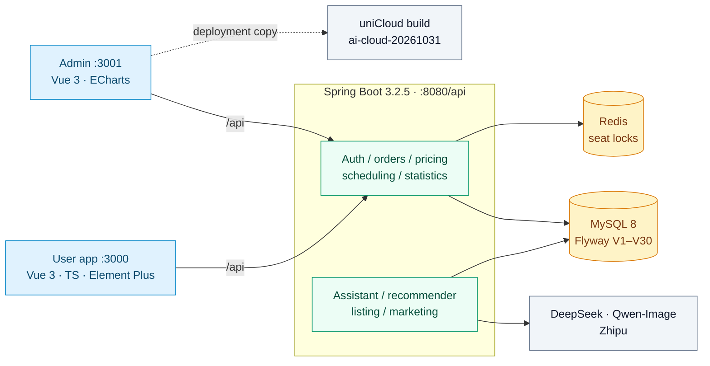

<div align="center">


# Xiangzhi Movie · Smart Movie Ticket System

**A one-stop cinema ticketing platform — from discovery and price comparison to seat selection and admission check-in**

[](https://github.com/jinli1156/Smart-Movie-System/stargazers)
[](https://github.com/jinli1156/Smart-Movie-System/network/members)
[](https://github.com/jinli1156/Smart-Movie-System/issues)
[](LICENSE)

[](https://spring.io/projects/spring-boot)
[](https://openjdk.org/)
[](https://vuejs.org/)
[](https://www.typescriptlang.org/)
[](https://www.mysql.com/)
[](https://redis.io/)
[](https://unicloud.dcloud.net.cn/)

[🎬 Live Demo](https://www.jinli115.cn/?v=demand-home-20261031) · [🚀 Quick Start](#-quick-start) · [🧩 Features](#-features) · [🏗 Architecture](#-architecture) · [中文文档](README.md)

</div>

> Docs updated **2026-11-01 (UTC+8)**. Features reflect the current source tree; test and deployment results belong to the dated records linked below.

## ✨ What makes it different

| | Capability | Notes |
| :---: | --- | --- |
| 🎟️ | **End-to-end ticketing** | Movie → cinema → showtime → seat → order → mock payment → ticket pickup → review / refund, all behind real business rules |
| 🤖 | **AI movie assistant** | 15 business tools, multi-turn SSE streaming, iterative watch planning, 5-minute checkout card with idempotent confirmation |
| 💸 | **Smart price comparison** | Same-day cross-cinema total-after-discount ranking, sharing one price calculator with the payment path |
| 📊 | **Reproducible recommender experiments** | Hybrid recommender (time decay / scene / content / trend / diversity re-rank) with strict time-based leave-one-out evaluation and ablations |
| 🧠 | **Intelligent scheduling** | OR-Tools CP-SAT multi-objective optimization, timeline editing, draft persistence and conflict protection (409) |
| 📤 | **AI listing & AIGC marketing** | Extract movie / cinema / hall documents into reviewable drafts; batch copywriting and posters with review, publish and take-down |
| ☁️ | **Dual implementation** | Spring Boot service and a parallel uniCloud deployment, with every capability gap documented |

## 🎬 Screenshots

| User app · home | User app · AI movie assistant |
| :---: | :---: |
|  |  |

| Admin console · sign-in |
| :---: |
|  |

Screenshots were updated on November 1, 2026. Live data and availability may change.

## 🚀 Quick Start

**Prerequisites:** JDK 21, MySQL 8.0+ (`utf8mb4`), Node.js 18+. Redis is embedded by default; Docker is only needed for integration tests. Maven Wrapper (3.9.16) is bundled. Set the database credentials and other required environment variables as described in the [setup guide](docs/GETTING_STARTED.md) before starting.

```powershell
# 1) create an empty database
mysql --default-character-set=utf8mb4 -u root -p --execute="SOURCE movie-ticket-backend/src/main/resources/db/schema.sql;"

# 2) start the backend and let Flyway apply migrations through V30
cd movie-ticket-backend
.\mvnw.cmd spring-boot:run
```

```powershell
# 3) optional: stop the backend, return to the repository root, then reset demo data
mysql --default-character-set=utf8mb4 -u root -p --execute="SOURCE movie-ticket-backend/src/main/resources/db/data.sql;"
```

The optional reset **erases and recreates business data**. Restart the backend afterward. Open two fresh terminals at the repository root for the frontends:

```powershell
cd movie-ticket-user
npm ci
npm run dev      # http://localhost:3000
```

```powershell
cd movie-ticket-admin
npm ci
npm run dev      # http://localhost:3001
```

Backend API prefix: `http://localhost:8080/api`. Demo accounts: `admin / admin123` (platform admin), `cinema_admin / admin123` (cinema admin, bound to cinema 1), `user1 / admin123` (regular user).

## 🧩 Features

<details>
<summary><b>User app</b> — <code>movie-ticket-user</code></summary>

- Captcha login, JWT sessions, route guards, profile and password management; the backend re-checks account status, role and cinema scope on every request.
- Movie search and filters, now-showing / upcoming, detail with trailers and box office; cinema list with distance, map link and showtime lookup.
- Full purchase flow: showtime → visual seat map → couple-seat recommendation → order confirm → price quote → mock payment → order list / detail → cancel, timeout and refund.
- Ticket pickup by QR code (camera or manual input) and post-viewing reviews that feed back into movie ratings.
- Watchlist, cold-start genre preferences, coupons, redemption codes, points deduction and a five-dimension preference radar.
- Hall layouts with disabled seats and multiple vertical aisles; seat adjacency never crosses an aisle.

</details>

<details>
<summary><b>AI assistant</b> — <code>/assistant</code></summary>

- Answers are grounded in real movies, cinemas, showtimes, seats, the caller's own orders and quotes; ticketing rules are served from a local knowledge base.
- Iterative planning remembers date, time, party size, budget, rating, duration, cinema, seat preference, adjacency, exclusions and scene, and accepts incremental edits such as "move it to tomorrow, keep the rest".
- Confirmation cards are valid for 5 minutes; on confirm the server re-checks inventory, price and discounts, then creates the pending order. Duplicate confirmations return the same order.
- Multi-turn streaming, stop generation, result cards, speech input and read-aloud; the assistant reports an explicit state when no model is configured.

</details>

<details>
<summary><b>Recommendation, pricing and coupons</b></summary>

- Popular, personalized and similar recommendations blending explicit preferences, browsing, watchlist, paid orders, reviews, content features, scene and recent trends, with time decay, diversity re-ranking and explanations.
- Strict time-based leave-one-out evaluation across the full hybrid model, popularity / content baselines and ablations, reporting Precision@K, Recall@K, NDCG@K, coverage and diversity with JSON export.
- One coupon per order plus up to 1 CNY of points (100 points = 1 CNY), always bounded by balance and remaining payable.
- Redemption codes validate validity window, enablement, issuance limit and per-account uniqueness; platform admins maintain codes and inspect redemptions.

</details>

<details>
<summary><b>Admin console</b> — <code>movie-ticket-admin</code></summary>

- CRUD for movies, cinemas, halls, showtimes, orders and users; poster / image upload; order cancel, refund and ticket check-in.
- Dashboard, box-office ranking, revenue trend and showtime statistics; admin-only recommender experiments and coupon-code management.
- **AI listing** (`/listing`): upload movie / cinema / hall material, extract into a reviewable draft with source comparison, save, reject and publish; Excel / CSV / JSON templates, PDF / DOCX / text / image input, up to 20 rows per batch, hall scope enforced for cinema admins.
- **Scheduling workbench**: draft a full day, edit on a timeline, swap movies, adjust times and base prices, add or remove unlocked showtimes, diff and apply.
- **Constraints and prediction**: CP-SAT optimizes revenue, occupancy and movie diversity under hall conflicts, runtime, cleaning gaps, release dates, per-movie caps and prime time; forecasting uses out-of-time testing with MAE, RMSE, MAPE and baselines.
- **Draft and publish protection**: server-side drafts per user, version and inventory checks on apply, HTTP 409 on conflict.

</details>

<details>
<summary><b>AIGC marketing, posters and souvenir tickets</b></summary>

- Marketing workbench with creation, tasks / assets and review / publish tabs: batch copywriting and posters per cinema and movie, versioned content, admin review, idempotent publishing, validity window and take-down.
- Image generation supports Alibaba Cloud DashScope `qwen-images` (locally `qwen-image-3.0`, text plus optional character reference), with OpenAI Images compatible and Zhipu protocols kept available; text reuses DeepSeek, falling back to Zhipu.
- User app `/posters` generates personalized movie posters (six styles, three aspect ratios, async jobs, history, PNG download / share).
- Paid orders can generate a starry souvenir ticket: AI background, program-drawn real order data, explicitly marked as not an admission ticket.

</details>

## 🏗 Architecture



| Layer | Stack | Version |
| --- | --- | --- |
| Backend | Spring Boot / Java | 3.2.5 / 21 |
| Backend | Spring Security + jjwt | 0.12.5 |
| Backend | MyBatis-Plus / Flyway | 3.5.6 / V1–V30 |
| Backend | MySQL / Redis | 8.0+ / 7 (embedded by default) |
| Backend | OR-Tools CP-SAT | 9.11.4210 |
| Frontend | Vue 3 / TypeScript / Vite | 3.4 / 5.3 / 5.1 |
| Frontend | Element Plus / Pinia / ECharts | 2.6 / 2.1 / 5.5 |
| Testing | JUnit 5 / Testcontainers / Playwright | 1.55 |
| Cloud | uniCloud (Alibaba Cloud) cloud functions + cloud DB | API `ai-cloud-20261031` |

## 🔌 Key API surface

<details>
<summary><b>Expand endpoints</b> (all under <code>/api</code>)</summary>

| Area | Endpoints |
| --- | --- |
| Auth & profile | `GET /auth/captcha`、`POST /auth/login`、`POST /auth/register`、`GET /user/me`、`PUT /user/profile`、`POST /user/change-password` |
| Catalog | `GET /movie/page`、`GET /cinema/page`、`GET /showtime/list`、`GET /showtime/{id}/seats` |
| Orders | `POST /order`、`GET /order/my`、`GET /order/{orderNo}`、`POST /order/{orderNo}/pay`、`POST /order/{orderNo}/cancel`、`POST /order/{orderNo}/refund`、`POST /order/pick` |
| Coupons | `GET /coupon/my`、`POST /coupon/redeem`、`GET/POST /admin/coupon-codes` |
| Pricing | `GET /pricing/compare`、`GET /pricing/orders/{orderNo}/quote` |
| Recommender | `GET /recommend/hot`、`GET /recommend/personal`、`GET /recommend/similar/{movieId}`、`GET /recommend/profile/radar`、`GET /recommend/evaluation` |
| Assistant | `GET /assistant/capabilities`、`POST /assistant/chat`、`POST /assistant/chat/stream`、`GET /assistant/conversations`、`GET/PUT /assistant/preferences` |
| Assistant checkout | `POST /assistant/checkout/prepare`、`POST /assistant/checkout/{id}/confirm` |
| Statistics & scheduling | `GET /statistics/dashboard`、`GET /statistics/scheduling/workspace`、`POST /statistics/scheduling/{check,apply,predict,simulate,optimize}` |
| Listing | `POST /listing/import`、`GET/POST /listing/drafts`、`GET/PUT /listing/drafts/{id}`、`POST /listing/drafts/{id}/{reject,publish}` |
| Marketing | `GET /admin/marketing/campaigns`、`POST /admin/marketing/campaigns/{id}/batches`、`POST /admin/marketing/versions/{id}/{submit-review,review,publish}`、`GET /marketing/placements` |
| Posters & souvenirs | `GET/POST /posters`、`GET /posters/{id}/file`、`GET/POST /souvenirs/orders/{orderNo}` |

Roles: `USER` (own data), `CINEMA_ADMIN` (cinema-scoped operations, hall-scoped AI listing), `ADMIN` (global operations, cinema assignment, marketing review). Permissions are re-evaluated from the database on every request, so role or scope changes take effect on the next call.

</details>

## ✅ Verification

| Date | Recorded result | Scope |
| --- | --- | --- |
| 2026-09-07 | 160 checks passed (77 backend fast, 24 real-dependency integration, 34 browser, 25 HTTP), both builds green | Model- and Docker-gated cases skipped |
| 2026-09-07 | 200 virtual users / 5 min, 59,658 requests, 0 failures, inventory and order consistency verified | Local machine, small dataset; not a production capacity claim |
| 2026-09-27 | 158/163 backend checks passed (5 model-gated skipped), real MySQL/Redis permission cases, 19 browser cases | Interaction-level evidence only |
| 2026-10-31 | 45/46 cloud-function regressions, 23 backend checks, 65 page regressions, live listing / marketing / poster flows incl. two real generations | Single test poster, souvenir ticket not generated for a real paid order |

```powershell
powershell -ExecutionPolicy Bypass -File scripts/verify.ps1              # fast tests + both builds
powershell -ExecutionPolicy Bypass -File scripts/verify.ps1 -Integration -E2E   # needs Docker
```

## ☁️ Deployment

| Entry | URL |
| --- | --- |
| User app (versioned entry) | <https://www.jinli115.cn/?v=demand-home-20261031> |
| Admin console | <https://www.jinli115.cn/admin/> |
| API health | <https://fc-mp-e7a16837-eb5c-4898-8fbd-e967f4d747d6.next.bspapp.com/api/health> |

The uniCloud build runs 24 collections, `movie-api` plus an on-demand `movie-ai-worker` (max 2 jobs per call, 120 s ceiling, 24 h asset validity). Real cloud transactions, concurrency and failure recovery are still being validated; the Chinese README lists the remaining items.

## 📄 License

[MIT](LICENSE) © 2026 jinli1156

<div align="center">

**[⬆ Back to top](#xiangzhi-movie--smart-movie-ticket-system)**

</div>
