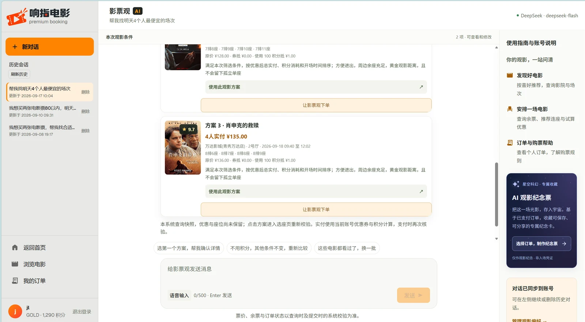
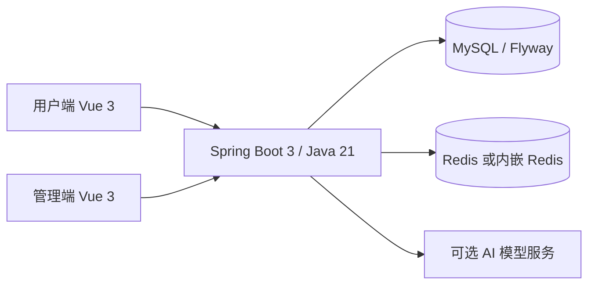

<div align="center">


# 响指电影

### 从发现电影到取票核销的智能购票系统

用户端、影院管理端与后端完整开源，包含 AI 观影规划、优惠比价、推荐实验和智能排片。

[](LICENSE)
[](movie-ticket-backend/pom.xml)
[](movie-ticket-user/package.json)
[](https://github.com/jinli1156/Smart-Movie-System/stargazers)

[在线体验](https://www.jinli115.cn/?v=demand-home-20261031) · [本地启动](#本地启动) · [功能与技术细节](README.details.md) · [English](README.en.md)

</div>

> 在线体验基于 [2026-10-31 部署记录](docs/DEPLOYMENT_AI_2026-10-31.md)。云服务和自定义域名状态可能变化；本地版是功能与算法说明的主要依据。支付为**模拟支付**，请勿用于真实交易。

## 能做什么

| 场景 | 已实现的能力 |
| --- | --- |
| 用户购票 | 电影与影院查询、场次选择、可视化选座、优惠试算、模拟支付、取票核销、评价和退票 |
| AI 观影助手 | 使用 15 个业务工具查询真实场次与座位；支持连续规划、推荐方案和用户确认后创建待支付订单 |
| 运营管理 | 电影、影院、影厅、场次、订单与账号管理；按影院隔离数据，支持扫码或手动核销 |
| 智能运营 | 混合推荐与时间切分评估、CP-SAT 智能排片、AI 辅助上架、营销文案与海报生成 |

**适合**学习完整票务业务链路、前后端协作、推荐实验和 AI 工具调用的开发者。AI 服务需要自行配置密钥；基础购票流程可以独立运行。各功能的条件与边界见 [完整说明](README.details.md#-功能地图)。

## 看一眼界面

| 用户端：首页 | AI 观影助手 |
| :---: | :---: |
|  |  |

<details>
<summary>展开查看管理端登录页</summary>


</details>

## 本地启动

需要 **JDK 21、MySQL 8.0+、Node.js 18+**。仓库提供 Maven Wrapper；开发配置默认使用内嵌 Redis。下面命令适用于 Windows PowerShell，均从仓库根目录开始。

### 1. 配置环境

将 [`.env.example`](.env.example) 中的 `DB_URL`、`DB_USERNAME`、`DB_PASSWORD` 和 `JWT_SECRET` 配到系统环境变量或 IDE 运行配置。Spring Boot **不会自动读取** `.env.example`。

### 2. 初始化数据库并启动后端

创建数据库并首次启动后端，等待 Flyway 完成迁移：

```powershell
mysql --default-character-set=utf8mb4 -u root -p --execute="SOURCE movie-ticket-backend/src/main/resources/db/schema.sql;"
cd movie-ticket-backend
.\mvnw.cmd spring-boot:run
```

若需要演示账号和排片，停止后端，回到仓库根目录导入演示数据，再重新启动后端：

```powershell
mysql --default-character-set=utf8mb4 -u root -p --execute="SOURCE movie-ticket-backend/src/main/resources/db/data.sql;"
```

**注意：导入会清空并重建业务数据，只能用于可丢弃的演示库。**

### 3. 启动两个前端

分别在两个新的仓库根目录终端执行：

```powershell
cd movie-ticket-user
npm ci
npm run dev
```

```powershell
cd movie-ticket-admin
npm ci
npm run dev
```

打开 [用户端](http://localhost:3000) 或 [管理端](http://localhost:3001)；后端 API 为 `http://localhost:8080/api`。导入演示数据后可用 `user1`、`cinema_admin` 或 `admin` 登录，本地演示密码均为 `admin123`。完整配置、排错与演示顺序见 [启动与验收指南](docs/GETTING_STARTED.md)。

## 架构与实现



| 工程 | 用途 |
| --- | --- |
| [`movie-ticket-user`](movie-ticket-user/) | 用户端，Vue 3、TypeScript、Vite、Element Plus |
| [`movie-ticket-admin`](movie-ticket-admin/) | 管理端，含运营与算法工作台 |
| [`movie-ticket-backend`](movie-ticket-backend/) | 业务 API、库存与订单事务、推荐和排片 |
| [`movie-ticket-unicloud`](movie-ticket-unicloud/) | 独立云端实现；部分算法与本地版不同 |

业务链路、数据模型、权限及两套实现的差异见 [架构说明](docs/ARCHITECTURE.md) 与 [完整说明](README.details.md#-系统架构)。

## 验证与项目状态

在仓库根目录运行快速验证（后端测试与两个前端生产构建）：

```powershell
powershell -ExecutionPolicy Bypass -File scripts/verify.ps1
```

真实依赖集成测试和浏览器测试的运行方法见 [测试指南](docs/TESTING.md)。历史结果按日期、环境和范围记录，不能直接代表当前提交或生产环境的通过情况。

- **已实现：** 购票闭环、模拟支付、权限隔离、推荐实验、智能排片、AI 助手和运营工作台。
- **仍需验证或完善：** 云端真实并发与故障恢复、正式支付渠道、CI 与容器化部署。云端排片采用启发式方案，未迁移本地 CP-SAT 求解器。
- **部署记录：** [2026-10-31 实际部署与限制](docs/DEPLOYMENT_AI_2026-10-31.md)。演示服务的持续可用性不作保证。

## 继续了解

| 想了解 | 文档 |
| --- | --- |
| 从零运行、账号与排错 | [启动与验收](docs/GETTING_STARTED.md) |
| 完整功能、API、配置和 Roadmap | [详细项目说明](README.details.md) |
| AI 助手与确认下单 | [电影助手](docs/MOVIE_ASSISTANT.md) · [确认下单](docs/ASSISTANT_CHECKOUT.md) |
| 推荐与排片实验 | [推荐评估](docs/RECOMMENDATION_EVALUATION.md) · [智能排片](docs/AI_SCHEDULING.md) |
| 数据库与测试 | [数据库指南](docs/DATABASE.md) · [测试指南](docs/TESTING.md) |
| 云端版本 | [uniCloud 工程](movie-ticket-unicloud/README.md) |

## 参与项目

欢迎通过 [Issue](https://github.com/jinli1156/Smart-Movie-System/issues) 报告可复现的问题，或提交 [Pull Request](https://github.com/jinli1156/Smart-Movie-System/pulls)。提交前请运行上面的快速验证，并在 PR 中写明改动、验证方法与结果。若项目对你有帮助，欢迎点个 [Star](https://github.com/jinli1156/Smart-Movie-System) 或分享给正在学习票务系统的开发者。

本项目采用 [MIT License](LICENSE)。
